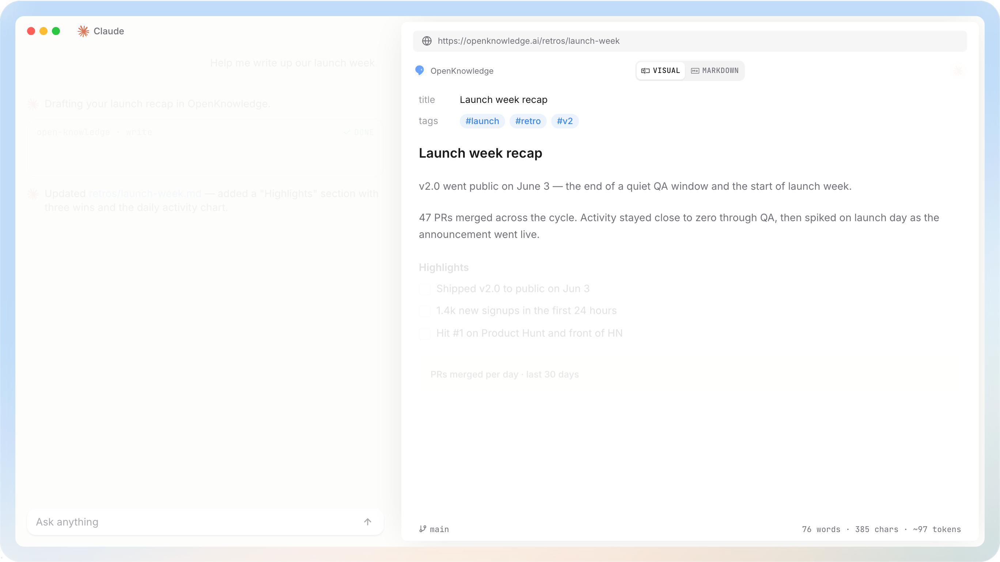

<p>
  <a href="https://github.com/fractalmandala/palimpsest"><picture>
    <source media="(prefers-color-scheme: dark)" srcset="assets/palimpsest-wordmark-dark.svg">
    
  </picture></a>
</p>

<p>
<b>Palimpsest</b> is a beautiful markdown editor with integrations with Claude, Codex, and other harnesses. For knowledge bases, LLM wikis, specs, and notes. Private, local, and free.

</p>

<div >
  <a href="https://github.com/fractalmandala/palimpsest">repository</a>
  <span>&nbsp;&nbsp;•&nbsp;&nbsp;</span>
  <a href="https://github.com/fractalmandala/palimpsest/releases">desktop app</a>
  <span>&nbsp;&nbsp;•&nbsp;&nbsp;</span>
  <a href="https://github.com/fractalmandala/palimpsest/tree/main/docs/content">docs</a>
</div>

<br/>



> **Fork notice:** Palimpsest is an independent fork of [OpenKnowledge](https://github.com/inkeep/open-knowledge) by [Inkeep](https://inkeep.com). See [NOTICE.md](./NOTICE.md) for the upstream acknowledgement and license terms. Brand assets (logo, wordmark, hero image) are being replaced — see [assets/brand/](./assets/brand/).

# Features

Highlights:
- Full true **WYSIWYG** so that editing markdown files feels like editing a Google Doc or Notion page.
- **Desktop app** (macOS, Windows, Linux) and **web UI** with file navigator, search, tabs, graph wiki link viewer, and more.
- Integrated **side-by-side AI-editing** with **Claude, Codex, OpenCode, Pi and others**. Can be used with any harness/agent via MCP/CLI.
- Out-of-the-box **MCP**, **skills**, and **agentic search** for LLM Wikis, second brains, and knowledge graphs.
- No-code **Team sharing** and **Auto-sync** powered by git/GitHub under the hood.
- **Embeddable HTML** and rich components for writing engineering specs and visualized reports.

## Install

**Desktop app** — download it from the [latest release](https://github.com/fractalmandala/palimpsest/releases/latest):

- **macOS** (Apple Silicon): open the DMG and drag **Palimpsest** to **Applications**.
- **Windows 10+** (x64 / Arm64): run the Setup installer — per-user, no admin prompt.
- **Linux** (x64 / arm64): install the deb (Debian/Ubuntu) or rpm (Fedora/RHEL) package.

**Web app** — on any platform (including Intel Macs and servers), run the same editor as a local web app via the CLI ([Node.js 24+](https://nodejs.org) and git required):

```bash
npm install -g @palimpsest/cli
cd your-project
ps init          # scaffold the project + wire up your AI editors (Claude Code, Claude Desktop, Cursor, Codex, OpenCode, OpenClaw)
ps start         # serve the web editor and open it in your browser (pass --no-open-browser to skip)
```

The `palimpsest` command is also installed as an alias of `ps`.

## Usage

Use Palimpsest by opening any existing folder on your computer that contains markdown or mdx files. The app can be used with existing codebases, wikis, Obsidian vaults, etc.

Think of it as Notion meets VS Code.

You can use it simply as a rich, WYSIWYG markdown editor to start. For existing files or plain notes/docs.

To get more complex, you can use the starter packs to create LLM Wikis, second brains, or more structured knowledge bases.

Either way, the app will walk you through installing the MCP and skills for agent harnesses detected on your computer. These are designed to help agents with enriched search + authoring of documents.

Git/GitHub based sync and sharing can optionally be enabled.

Docs for general usage: <https://github.com/fractalmandala/palimpsest/tree/main/docs/content>.

## Development

Prerequisites: [Node.js 24](https://nodejs.org), [pnpm 12](https://pnpm.io/installation) (`corepack enable pnpm`), [rustup](https://rustup.rs) (Rust toolchain auto-installs on first build), and git.

```bash
pnpm install
```

**Run the web editor** (http://localhost:5173):

```bash
cd packages/app && pnpm run dev
```

**Run the desktop app in dev mode** (hot-reload Electron shell):

```bash
cd packages/desktop && pnpm run dev
```

**Build the installable macOS .dmg** (Apple Silicon, unsigned):

```bash
pnpm exec turbo run build --filter='!@palimpsest/docs'   # full workspace build (docs site excluded: unrelated typecheck breakage)
cd packages/desktop && pnpm run build:mac:unsigned        # → dist-desktop/Palimpsest-arm64.dmg
```

> Packaging **requires pnpm 12** (the repo's `packageManager` pin). Building with pnpm 11 silently drops `@palimpsest/core` from the app bundle and the installed app crashes on launch with `ERR_MODULE_NOT_FOUND`.

The unsigned .dmg is not notarized — on first launch, right-click → Open to run it. Signed builds need an Apple Developer identity (see `packages/desktop/electron-builder.yml`).

See [CONTRIBUTING.md](./CONTRIBUTING.md) for the full development setup, toolchain pins, and checks (`pnpm run check`).

## Contributions

The best way to contribute is a detailed [issue](https://github.com/fractalmandala/palimpsest/issues/new/choose): we build and review the change ourselves. Pull requests are welcome for small fixes, and for larger changes once a maintainer has accepted the issue.

See [CONTRIBUTING.md](./CONTRIBUTING.md) for details.

## License

Palimpsest is licensed under [GNU General Public License v3.0 or later](./LICENSE), an OSI-Approved open source license, inherited from its upstream project.

## Community & Support

Feel free to <a href="https://github.com/fractalmandala/palimpsest/issues/new/choose">file an issue</a>. We're always looking for ideas and requests.

<p>
  ⭐️ If you'd like to support this project, consider <a href="https://github.com/fractalmandala/palimpsest">starring the repo</a> ⭐️
</p>
